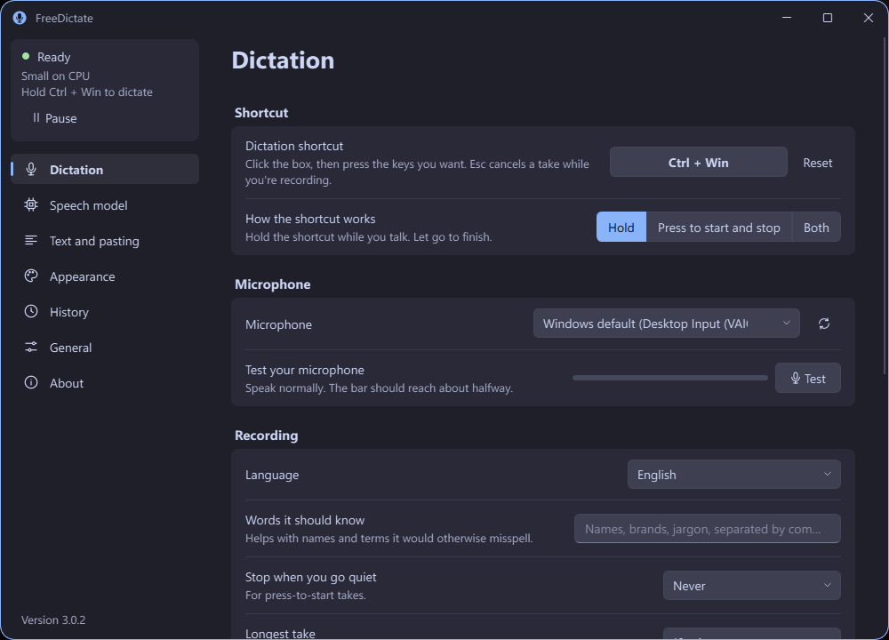
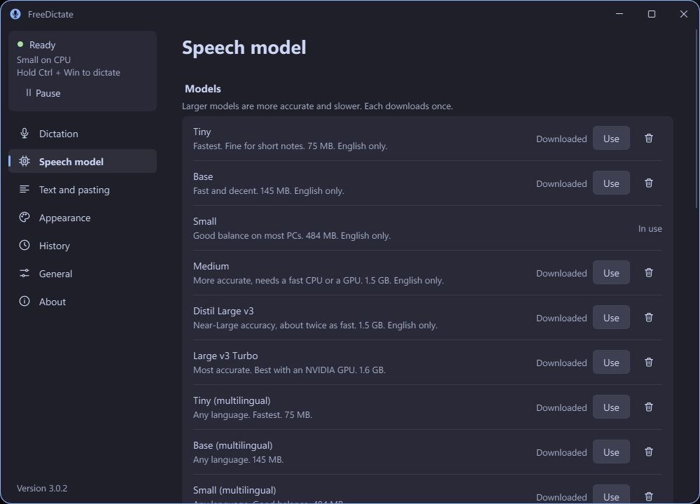
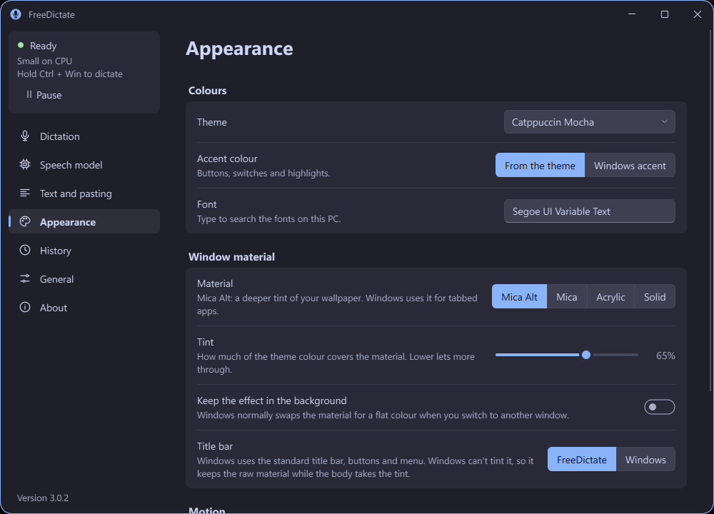

# FreeDictate

Unlimited local speech-to-text dictation for Windows 11. Hold a shortcut, speak, let go — the text lands at your cursor. No account, no cloud, no weekly limit. Audio never leaves your PC.

<p align="center">
  
</p>
<p align="center">
  
  &nbsp;
  
</p>

## How it works

1. Click any text field.
2. Hold **Ctrl+Win** (the default hotkey) and speak.
3. Release. The transcript is pasted at your cursor.

**Esc** cancels a take. In *toggle* mode a short press starts and a second press stops; in *both* mode a tap latches and holding pushes to talk. A small overlay near your cursor shows the input level and a timer while you speak.

## Download

Grab the newest release from [github.com/DavidHiFi/freedictate/releases/latest](https://github.com/DavidHiFi/freedictate/releases/latest). Every release ships two builds:

| File | What it is |
| --- | --- |
| `FreeDictate-<version>-Setup.exe` | The installer. Per-user by default, no admin prompt. |
| `FreeDictate-<version>-Portable.zip` | Portable build. Extract anywhere and run `FreeDictate.exe`. |
| `SHA256SUMS` | Checksums for the files above. |

No Python, no dependencies: both builds are frozen executables that bundle everything, the Visual C++ runtime included, so nothing else needs installing. They run on 64-bit Windows 10 1809 or later; the window materials need Windows 11 22H2. GPU acceleration is optional: on a PC with an NVIDIA card, Settings → *Speech model* downloads NVIDIA's libraries in one click (only the NVIDIA driver is needed).

## Install

Run `FreeDictate-<version>-Setup.exe`. It installs to your profile by default (no admin needed; you can pick *all users* on the first page), offers a startup shortcut and an optional desktop icon, and adds an entry to *Apps › Installed apps* for clean removal. On the first launch, pick a voice model in Settings — it downloads once, then dictation is fully offline.

Updating is built in: Settings → *General* → *Check for updates*. FreeDictate downloads the new build from GitHub Releases, verifies it against `SHA256SUMS`, and restarts itself.

## Portable

Extract the zip wherever you like — a USB stick works — and run `FreeDictate.exe`. A `portable.txt` marker next to the exe tells FreeDictate to keep everything (settings, history, downloaded models) in a `data\` folder beside it, so the whole folder moves with you and nothing is written to the registry or AppData. The portable build can update itself the same way, keeping your `data\` folder.

## Settings

Everything lives in one window with seven pages:

- **Dictation** — hotkey and mode, microphone with a live level test, sounds and volume, auto-stop on silence, vocabulary hints passed to the model, pause.
- **Speech model** — pick a Whisper model: from *Tiny* (75 MB, fastest) to *Large v3 Turbo*, English-only or multilingual, CPU or NVIDIA GPU. A fallback model keeps dictation working while a new one downloads.
- **Text and pasting** — filler removal, capitalization, end punctuation, voice commands ("new line", "new paragraph"), find-and-replace rules, output method (paste / Shift+Insert / type / clipboard only) and clipboard restore.
- **Appearance** — ten themes plus *Match Windows*, the Windows accent colour, any installed font, and the window material: **Mica Alt, Mica, Acrylic** or solid, with a tint slider. Backdrops need Windows 11 22H2 and transparency turned on; otherwise you get the solid look automatically. The title bar can be FreeDictate's own or the standard Windows one; with the Windows title bar the material runs under it and the tint covers the body (Windows can't tint its own caption, which keeps the raw material).
- **History** — searchable dictation history in SQLite on your PC, retention in days, clear or export. Transcribe audio and video files here too.
- **General** — start at login (normal or elevated), update settings, prerelease channel, export/import settings.
- **About** — version, licences, links.

## Models

| Model | Size | Good for |
| --- | --- | --- |
| Tiny | 75 MB | Short notes, slow PCs |
| Base | 145 MB | Fast and decent |
| Small | 484 MB | The default; good balance |
| Medium | 1.5 GB | More accuracy |
| Distil Large v3 | 1.5 GB | Near-Large accuracy, ~2× faster |
| Large v3 Turbo | 1.6 GB | Most accurate; best with a GPU |
| multilingual variants | — | 30+ languages via *Detect automatically* |

With an NVIDIA GPU, Settings offers a one-click CUDA support download. Without it, everything runs on CPU.

## Privacy

Recording, transcription, history and settings stay on your PC. The only network traffic is the model download you choose and the optional update check against the GitHub Releases API — both visible and disableable in Settings. No telemetry, no accounts.

## If you also use Wispr Flow

Quit Wispr Flow or rebind its push-to-talk key before starting FreeDictate. Both listen for the same hotkey, so running both pastes twice.

## Building from source

```powershell
pwsh -File scripts\build.ps1
```

runs the test suite, freezes the app with PyInstaller, self-tests the frozen exe, compiles the Inno Setup installer, and zips the portable build into `dist\`. Pass `-SkipInstaller`, `-SkipTests` or `-Python <path>` as needed; see the header of `scripts\build.ps1`. Source layout: `src\freedictate` (core), `src\freedictate\ui` (settings window and overlay), `tests\`, `packaging\`.

## License

[MIT](LICENSE)
